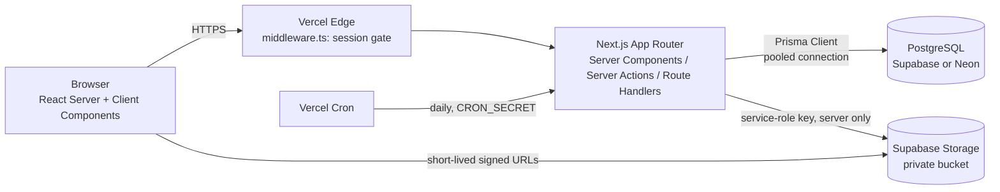
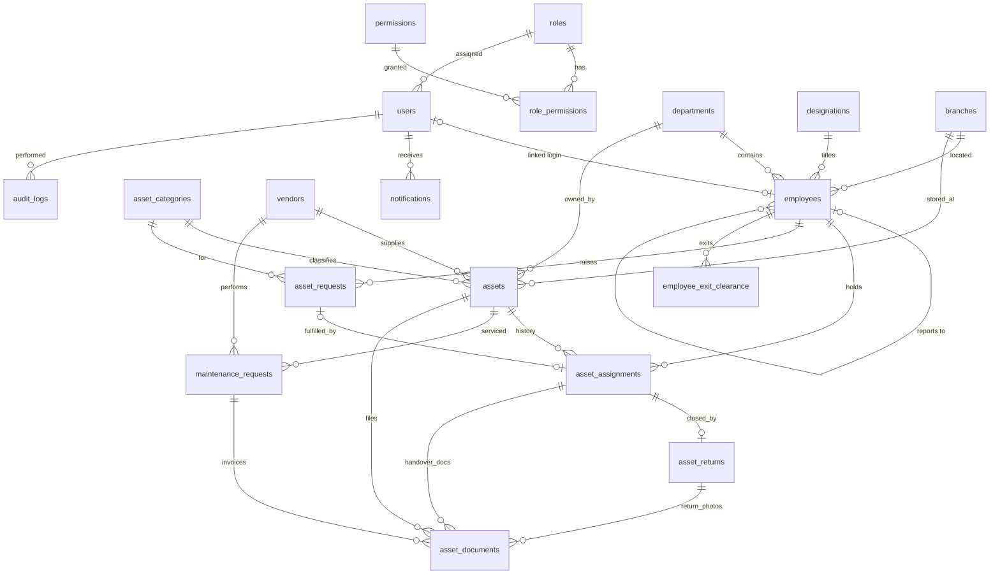

# EAMS — System Architecture

Enterprise Asset Management System: tracks company assets, who holds them, and everything that
happens to them from procurement to disposal.

## 1. High-level architecture



| Layer | Choice | Why |
|---|---|---|
| UI | Next.js App Router, React, Tailwind, shadcn/ui, Lucide, Recharts | Server components for data-heavy pages; shadcn gives an owned, consistent design system |
| Forms | React Hook Form + Zod | Same Zod schema validates on the client and again in the server action |
| Mutations | Server Actions (forms), Route Handlers (exports, uploads, cron) | No separate API server; works natively on Vercel serverless |
| Data | PostgreSQL + Prisma | Relational integrity, transactions, partial unique indexes |
| Auth | Auth.js v5, credentials (bcrypt), JWT session cookie | Users and roles live in our own DB; works with any Postgres host |
| Files | Supabase Storage, private bucket, signed URLs | No local filesystem persistence on Vercel |
| Jobs | Vercel Cron → `/api/cron/daily` | Warranty / overdue reminders without a long-running worker |

## 2. Authorization model (RBAC)

- `roles` and `permissions` are DB tables joined by `role_permissions`; each `user` has one role.
- Permissions are string keys like `asset:create`, `assignment:create`, `report:export`.
- The permission list is loaded into the JWT at sign-in, so checks cost no DB round-trip.
- **Every** server action / route handler calls `requirePermission(...)` before touching data.
  Hiding a button in the UI is only cosmetic.
- Employee-scoped data (`asset:read:own`, `request:create:own`) is filtered server-side by the
  user's linked `employee_id`; an employee can never fetch another employee's records by ID.

| Permission area | Super Admin | Admin / IT | HR | Employee |
|---|:-:|:-:|:-:|:-:|
| Users, roles, settings | ✅ | — | — | — |
| Assets CRUD, categories, vendors | ✅ | ✅ | read | own only |
| Employees | ✅ | ✅ | ✅ | self |
| Assign / return | ✅ | ✅ | read | acknowledge own |
| Maintenance | ✅ | ✅ | — | raise for own asset |
| Asset requests | ✅ approve | ✅ approve | read | create / cancel own |
| Exit clearance | ✅ | ✅ | ✅ initiate / complete | — |
| Reports & exports | ✅ | ✅ | ✅ | — |
| Audit log | ✅ | read | — | — |

## 3. Data model (ER diagram)



Key integrity rules

- **One active assignment per asset** — partial unique index
  `asset_assignments(asset_id) WHERE status = 'ACTIVE'`, plus status checks inside a
  `SERIALIZABLE` transaction. Concurrent double-assignment fails at the database.
- **One open exit clearance per employee** — partial unique index on
  `employee_exit_clearance(employee_id) WHERE status <> 'COMPLETED'`.
- Assign / return / clearance are single Prisma transactions that write the business rows, the
  asset status change, the audit log and the notifications together.
- Soft delete (`deleted_at`) on assets, employees, vendors and categories; history rows are never
  deleted.
- Money is `Decimal(12,2)`; all timestamps are `timestamptz`.

## 4. Folder structure

```
asset-management/
├─ prisma/
│  ├─ schema.prisma          # full data model
│  ├─ migrations/            # SQL migrations (incl. partial unique indexes)
│  └─ seed.ts                # roles, permissions, realistic demo data
├─ docs/                     # architecture, deployment, troubleshooting
├─ src/
│  ├─ app/
│  │  ├─ (auth)/login/       # public sign-in page
│  │  ├─ (app)/              # authenticated shell (sidebar + topbar)
│  │  │  ├─ dashboard/
│  │  │  ├─ assets/          # list, [id] detail, new, edit
│  │  │  ├─ employees/
│  │  │  ├─ assignments/     # assign + return flows
│  │  │  ├─ maintenance/
│  │  │  ├─ requests/
│  │  │  ├─ clearance/
│  │  │  ├─ reports/
│  │  │  ├─ my-assets/       # employee self-service
│  │  │  └─ settings/        # users, roles, categories, departments, branches, vendors
│  │  ├─ api/
│  │  │  ├─ auth/[...nextauth]/
│  │  │  ├─ export/[report]/ # CSV / XLSX / PDF
│  │  │  ├─ upload/
│  │  │  └─ cron/daily/
│  │  └─ layout.tsx
│  ├─ components/
│  │  ├─ ui/                 # shadcn primitives
│  │  ├─ layout/             # sidebar, topbar, page header
│  │  └─ shared/             # data table, status badges, empty states
│  ├─ features/<module>/     # per-module actions.ts, queries.ts, schemas.ts, components
│  ├─ lib/
│  │  ├─ auth/               # Auth.js config, permissions, guards
│  │  ├─ db.ts               # Prisma singleton
│  │  ├─ audit.ts
│  │  ├─ storage.ts          # Supabase Storage wrapper
│  │  └─ utils.ts
│  ├─ auth.ts                # Auth.js entry
│  └─ middleware.ts          # redirects unauthenticated users
├─ .env.example
└─ vercel.json               # cron schedule
```

## 5. Delivery phases

1. **Setup, schema, auth, RBAC, app shell** ← current
2. Dashboard, employees, categories / master data, asset inventory
3. Assignment, handover acknowledgement, returns
4. Maintenance, asset requests
5. Reports and Excel / CSV / PDF exports
6. Exit clearance, notifications, audit log UI
7. Tests, hardening, security review, Vercel deployment
